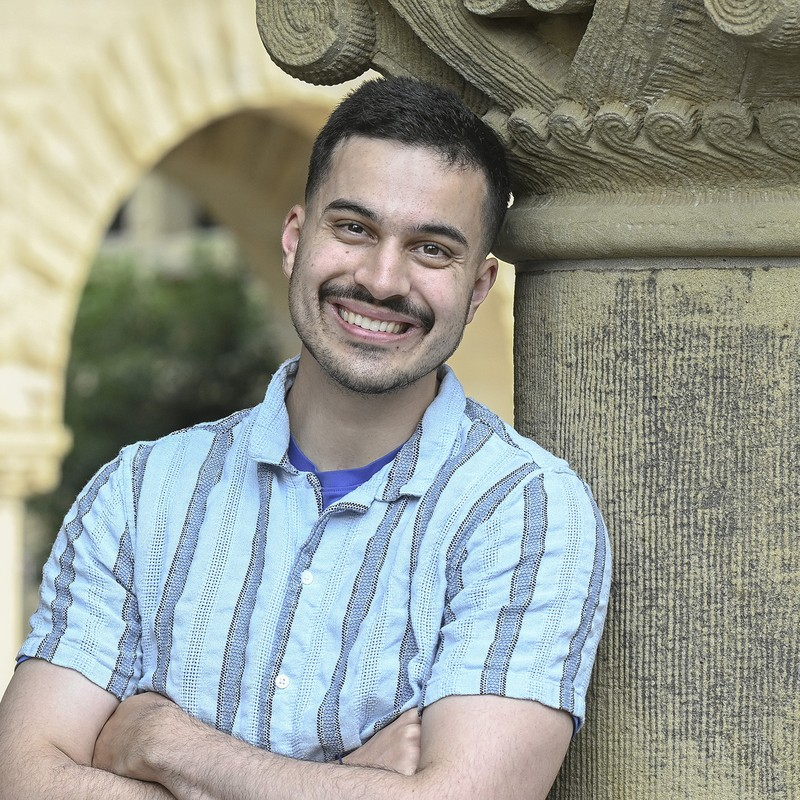

  

    <h1 class="sw-hero__name">Matt Strong</h1>
    
CS PhD student in Robotics and AI, Stanford University &middot; NSF Graduate Research Fellow

    <ul class="sw-links sw-links--icons">
      <li><a href="mailto:mastro1@stanford.edu" aria-label="Email" title="Email"><i class="fas fa-envelope" aria-hidden="true"></i></a></li>
      <li><a href="/cv.pdf" aria-label="CV" title="CV"><i class="fas fa-file-alt" aria-hidden="true"></i></a></li>
      <li><a href="https://scholar.google.com/citations?user=HHyGg9cAAAAJ&hl=en" aria-label="Google Scholar" title="Google Scholar"><svg viewBox="0 0 24 24" aria-hidden="true"><path d="M5.242 13.769L0 9.5 12 0l12 9.5-5.242 4.269C17.548 11.249 14.978 9.5 12 9.5c-2.977 0-5.548 1.748-6.758 4.269zM12 10a7 7 0 1 0 0 14 7 7 0 0 0 0-14z"/></svg></a></li>
      <li><a href="https://github.com/peasant98" aria-label="GitHub" title="GitHub"><i class="fab fa-github" aria-hidden="true"></i></a></li>
      <li><a href="https://www.linkedin.com/in/matthewhstrong" aria-label="LinkedIn" title="LinkedIn"><i class="fab fa-linkedin-in" aria-hidden="true"></i></a></li>
      <li><a href="https://x.com/MattStr10050461" aria-label="X (Twitter)" title="X (Twitter)"><svg viewBox="0 0 24 24" aria-hidden="true"><path d="M18.901 1.153h3.68l-8.04 9.19L24 22.846h-7.406l-5.8-7.584-6.638 7.584H.474l8.6-9.83L0 1.154h7.594l5.243 6.932ZM17.61 20.644h2.039L6.486 3.24H4.298Z"/></svg></a></li>
      <li><a href="https://www.strava.com/athletes/26495451" aria-label="Strava" title="Strava"><i class="fab fa-strava" aria-hidden="true"></i></a></li>
    </ul>
  

  

    
  

I'm a PhD student in Computer Science at Stanford, advised by [Monroe Kennedy](https://profiles.stanford.edu/monroe-kennedy) and [Jeannette Bohg](https://web.stanford.edu/~bohg/). I work on **data-efficient 3D vision and tactile sensing for robotics** and on **vision-only autonomous driving**, funded by the [NSF Graduate Research Fellowship](https://www.nsfgrfp.org).

Before Stanford, I was a **software engineer at Microsoft**. As an undergrad at CU Boulder, I did research in the [HIRO group](https://hiro-group.ronc.one) with [Alessandro Roncone](https://alessandro.ronc.one/) and the [SBS lab](https://www.colorado.edu/lab/sbs) with [Wangda Zuo](https://www.colorado.edu/ceae/wangda-zuo). I also received the **Stanford Centennial Teaching Award** ([spotlight](https://engineering.stanford.edu/spotlight/matt-strong)).

<h2 class="sw-section-title">Selected Work</h2>



  


<a href="/publications/">See all publications &rarr;</a>

